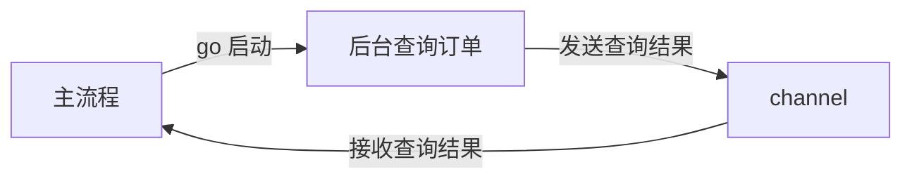

# Go 并发通信学习总览

这几章都围绕同一个问题：**后台任务在执行时，主流程怎样拿到结果、怎样等待，以及怎样知道任务结束了。**

可以把它们放进“后台查询订单”这个场景里理解。

## 先认识 goroutine 和 channel

- **goroutine**：一个可以与其他任务并发推进的执行流程。`go 查询订单()` 会启动一个新的 goroutine。
- **channel**：任务之间传递数据的通道。后台把结果发进去，主流程从中接收。



**goroutine 负责执行任务，channel 负责传递消息。**

## 一个最小例子

下面用字符串模拟后台查询结果。这是完整程序，可以单独保存为 Go 文件运行：

```go
package main

import "fmt"

func main() {
	result := make(chan string) // 创建通信通道。

	go func() {
		result <- "订单查询完成" // 后台发送结果。
	}()

	message := <-result // 主流程等待结果。
	fmt.Println(message)
}
```

输出：

```text
订单查询完成
```

箭头表示数据传递的方向：

| 写法 | 含义 | 在上例中的位置 |
| --- | --- | --- |
| `result <- "订单查询完成"` | 把值发送给 channel | 后台 goroutine |
| `message := <-result` | 从 channel 接收值 | 主流程 |

主流程执行接收时，如果结果还没准备好，就会在那里等待。**后面几章，基本都是围绕这个“等待”做不同安排。**

这个例子只接收一次，收到结果后就继续执行，不需要依靠关闭 channel 来结束接收循环。

## 第一组问题：我愿意怎样等？

| 方式 | 用人话理解 | 对应章节 |
| --- | --- | --- |
| 直接接收 `<-result` | 结果没来，我就在这里等 | channel 的基础行为 |
| `select + default` | 现在有结果就拿，没有就先做别的 | Non-Blocking Channel Operations |
| `select + time.After` | 我可以等，但要设置等待期限 | Timeouts |

例如，给等待订单查询结果设置 1 秒的期限：先把通道创建改为 `result := make(chan string, 1)`，再把上例的接收和打印两行替换为下面的代码，同时在 `import` 中引入 `time` 包。

这个缓冲位置可以保存超时后才发送的单条结果，让后台发送完成。本例只发送一次，因此容量为 `1` 足够。

```go
select {
case message := <-result:
	fmt.Println(message)
case <-time.After(time.Second):
	fmt.Println("查询超时")
}
```

这里在等两种通知：

- 查询结果来了。
- 等待时间到了。

执行其中一个分支后，这次 `select` 就结束。

**主流程超时离开后，后台查询可能仍在执行。** 超时只处理了“主流程还等不等”这个问题。

## 第二组问题：如果结果有很多条，怎样知道全部收完了？

假设另一个 channel `results` 用来连续返回多条订单：

```text
订单 A
订单 B
订单 C
```

收到 C 后，接收方怎么知道后面还有没有 D？

发送方可以在所有数据发送完毕后执行 `close(results)`，表达“我以后不会再往这个 channel 发送数据了”。这就是 **Closing Channels**。

接收方可以通过 `order, ok := <-results` 检查接收结果。`ok == false` 表示：**channel 已关闭，而且之前发送的数据都已经收完。**

如果要一直接收，就可以使用 **Range over Channels**。下面的代码放在接收方的函数中，使用 `fmt` 包：

```go
for order := range results {
	fmt.Println(order)
}
```

它帮你重复做三件事：

```text
接收一条数据 → 处理它 → 再接收下一条
```

直到 channel 关闭且排空，循环才自然结束。因此，这两章是一起使用的：

- **close**：发送方说明“后面没有了”。
- **range**：接收方持续接收，收完后结束。

channel 暂时为空时，`range` 会等待，因为以后还可能有人发送。关闭后缓冲区里已有的数据仍然可以接收。

## 第三组问题：怎样让“时间到了”也变成一条通知？

这就是 **Timers**。下面的代码放在 `main` 函数中，需要 `fmt` 和 `time` 包：

```go
timer := time.NewTimer(2 * time.Second)
<-timer.C
fmt.Println("时间到了")
```

可以把 Timer 理解成一个一次性的闹钟：

- `NewTimer`：设定闹钟，开始计时。
- `timer.C`：接收闹钟通知的 channel。
- `<-timer.C`：等待闹钟响。
- `timer.Stop()`：尝试取消这次闹钟通知。

这也解释了 Timeouts 为什么能把时间和查询结果放进同一个 `select`：**它们都通过 channel 提供通知。**

但 Timer 的 channel 有一个特点：**通知一次后，它不会自动关闭。**

所以下面是会持续等待的反例，不要作为可正常结束的程序运行：

```go
timer := time.NewTimer(time.Second)
for t := range timer.C {
	fmt.Println(t)
}
```

接收一次通知后，它还会继续等下一次，不会自然结束。成功停止 Timer，也不会关闭 `timer.C` 或自动结束等待它的 goroutine。

## 五章的对应关系与运行入口

以下命令都在项目根目录执行。

| 章节 | 它到底解决什么问题 | 运行示例 |
| --- | --- | --- |
| [Timeouts](./timeouts.go) | 最多等待多久？ | `go run ./examples/timeouts.go` |
| [Non-Blocking Channel Operations](./non-blocking-channel-operations/main.go) | 现在做不了，能否立即继续？ | `go run ./examples/non-blocking-channel-operations` |
| [Closing Channels](./closing-channels/main.go) | 怎样通知接收方“以后没有数据了”？ | `go run ./examples/closing-channels` |
| [Range over Channels](./range-over-channels/README.md) | 怎样持续接收，直到数据全部收完？ | `go run ./examples/range-over-channels` |
| [Timers](./timers/README.md) | 怎样在未来某个时间发出一次通知？ | `go run ./examples/timers` |

## 自测

1. 后台通过什么把查询结果交给主流程？
2. “暂时没有结果”和“以后不会再有结果”，分别对应什么状态？
3. 主流程不想继续等待时，后台任务会自动停止吗？

本总览先省略 `Stop` 返回值、版本差异和取消机制的实现细节。先记住：超时或停止计时都不会自动终止后台任务。
